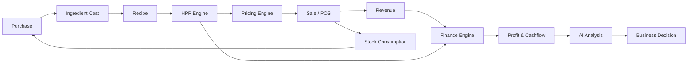
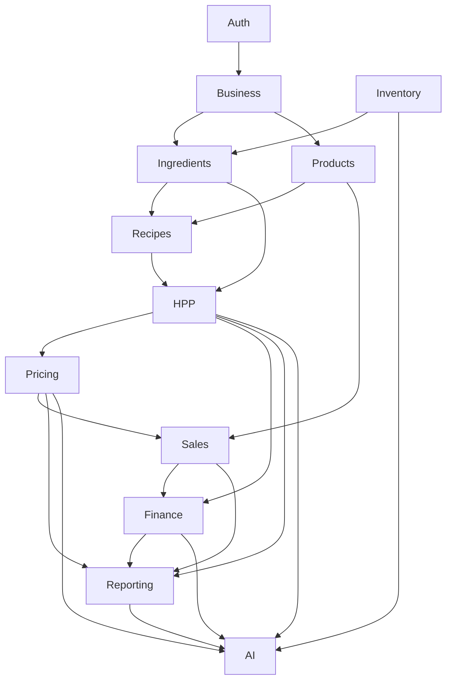
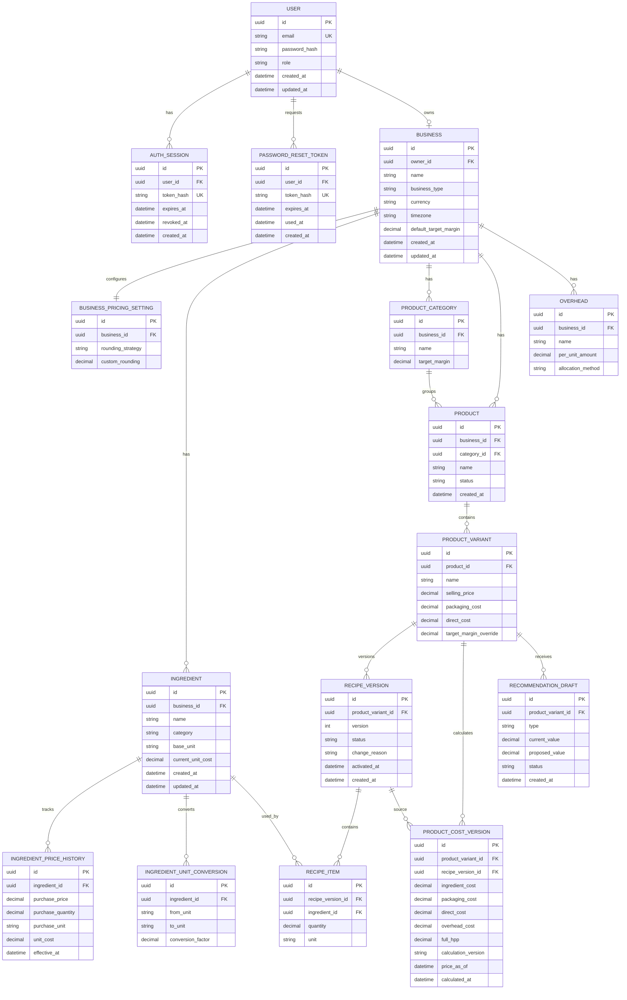
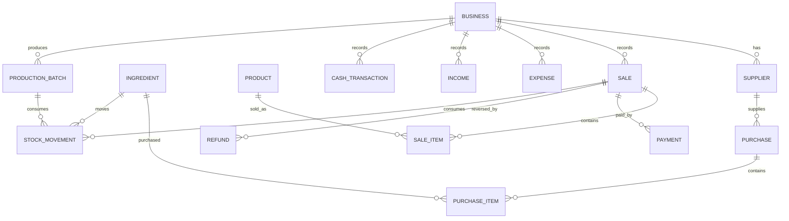
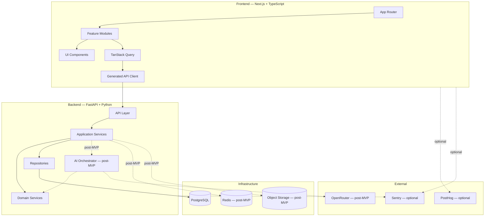

# PRD — M0neyku v2.0

> Dokumen ini adalah sumber kebenaran produk dan arsitektur untuk MVP M0neyku.
> Dokumen lama yang menyebutnya sebagai addendum dianggap sudah digabung ke sini.
> Implementasi tidak dimulai sebelum acceptance criteria MVP pada dokumen ini terpenuhi.
>
> - Frontend → Next.js + TypeScript
> - Backend → FastAPI + Python
> - AI Services → Python
> - Database → PostgreSQL
> - Architecture → Modular Monolith
> - API Contract → OpenAPI

---

# 0. Product Contract

## Tujuan Produk

M0neyku membantu pemilik UMKM makanan/minuman menghitung biaya produk secara konsisten
dan menetapkan harga jual berbasis margin. MVP berfokus pada perhitungan deterministik yang
dapat diaudit, bukan menjadi ERP penuh.

## Target User

- Pemilik atau operator UMKM makanan/minuman.
- Mengelola satu business tanpa team member pada MVP.
- Membutuhkan ingredient, recipe, HPP, dan rekomendasi harga yang mudah diverifikasi.

## Business Model MVP

- MVP digunakan sebagai pilot tanpa billing dan payment.
- Model komersial yang direncanakan: freemium setelah validasi produk.
- Subscription, payment, plan limit, dan invoicing berada di luar MVP.

## Keputusan MVP Terkunci

| Area | Keputusan |
|---|---|
| Repository | `frontend/` untuk Next.js, `backend/` untuk FastAPI |
| Business access | Satu user memiliki satu business; tanpa team member |
| Currency | IDR saja |
| Ingredient cost basis | Harga efektif terbaru berdasarkan `effective_at` |
| HPP formula | Ingredient cost + packaging cost + direct cost + allocated overhead |
| Pricing formula | `selling_price = full_hpp / (1 - target_margin)` |
| AI | Ditunda sampai core HPP + Pricing stabil |
| Financial authority | Backend Python dengan `Decimal` dan PostgreSQL `NUMERIC` |

## Scope MVP

1. Auth: register, login, logout, reset password.
2. Business profile dan pricing settings dasar.
3. Ingredients, price history, dan unit conversion.
4. Products, categories, variants, recipes, dan recipe version.
5. HPP calculation dan cost history.
6. Basic pricing: target margin, price recommendation, margin view, dan discount simulation.
7. Error contract, pagination, tenant isolation, dan audit-friendly calculation result.

## Out of Scope MVP

- Inventory, purchasing, supplier, stock movement, waste, dan production batch.
- POS, sales, payment, refund, dan reversal.
- Finance, income, expense, cashflow, profit/loss, dan reporting kompleks.
- Competitor pricing dan delivery fee simulation.
- AI assistant, OpenRouter, AI streaming, prompt orchestration, dan AI usage billing.
- OAuth, multi-business, team member, invitation, subscription, payment, dan invoicing.
- Redis, object storage, background jobs, Nginx, PostHog, dan Sentry sebagai dependency wajib.

## Milestone dan Exit Criteria

| Fase | Fokus | Exit criteria |
|---|---|---|
| 0 | Contract dan schema | Formula, enum, constraint, API error, dan scope disetujui |
| 1 | Auth dan business | Auth flow lengkap; data business terisolasi dan session aman |
| 2 | Catalog dan recipe | Ingredient, price history, product, variant, dan recipe version dapat dikelola |
| 3 | HPP dan pricing | Golden test HPP/pricing hijau; hasil memakai Decimal dan dapat ditelusuri |
| 4 | Pilot hardening | Acceptance criteria, security check, NFR check, dan UX error state terpenuhi |

## Success Metrics MVP

- 100% golden test calculation menghasilkan nilai yang sama dengan reference calculation.
- Minimal 80% peserta pilot dapat membuat ingredient → product → recipe → HPP tanpa bantuan.
- Tidak ada akses lintas-business pada authorization test.
- Endpoint non-streaming utama memiliki target p95 maksimal 500 ms pada dataset pilot.
- Setiap kegagalan domain utama menghasilkan semantic error code yang dapat ditangani frontend.

---

# 1. Product Roadmap / ERP Ecosystem

Diagram ini adalah roadmap setelah MVP, bukan daftar fitur yang harus dibangun sekarang.
M0neyku dapat berkembang bertahap menjadi **lightweight ERP untuk UMKM**, tetapi MVP
hanya mencakup Core HPP + Pricing pada bagian 0.

```mermaid
flowchart TB

    USER[User / Pemilik UMKM]

    USER --> DASHBOARD[Dashboard]

    DASHBOARD --> HPP[HPP Management]
    DASHBOARD --> PRICING[Pricing Management]
    DASHBOARD --> FINANCE[Finance]
    DASHBOARD --> INVENTORY[Inventory]
    DASHBOARD --> POS[POS / Sales]
    DASHBOARD --> REPORTS[Reports]
    DASHBOARD --> AI[AI Assistant]

    HPP --> INGREDIENTS[Ingredients]
    HPP --> RECIPES[Recipes]
    HPP --> OVERHEAD[Overhead]
    HPP --> COSTING[Product Cost]

    PRICING --> MARGIN[Margin]
    PRICING --> DISCOUNT[Discount Simulation]
    PRICING --> DELIVERY[Delivery Fee]
    PRICING --> COMPETITOR[Competitor Pricing]

    INVENTORY --> PURCHASE[Purchases]
    INVENTORY --> SUPPLIER[Suppliers]
    INVENTORY --> STOCK[Stock Movement]
    INVENTORY --> WASTE[Waste]
    INVENTORY --> BATCH[Production Batch]

    POS --> SALES[Sales]
    POS --> SALE_ITEM[Sale Items]
    POS --> PAYMENT[Payments]
    POS --> REFUND[Refund / Reversal]

    FINANCE --> INCOME[Income]
    FINANCE --> EXPENSE[Expense]
    FINANCE --> CASHFLOW[Cashflow]
    FINANCE --> PROFITLOSS[Profit & Loss]

    REPORTS --> PRODUCT_REPORT[Product Performance]
    REPORTS --> FINANCIAL_REPORT[Financial Report]
    REPORTS --> STOCK_REPORT[Inventory Report]

    AI --> HPP
    AI --> PRICING
    AI --> FINANCE
    AI --> INVENTORY
    AI --> REPORTS
```



---

# 2. Roadmap Hubungan Antar Modul ERP

Core business loop jangka panjang M0neyku:



Prinsip:

```text
Inventory menyediakan cost aktual
        ↓
HPP menentukan biaya produk
        ↓
Pricing menentukan harga
        ↓
POS menghasilkan transaksi
        ↓
Finance menghitung performa bisnis
        ↓
AI menjelaskan hasil
```

---

# 3. Domain Dependency Roadmap

Dependency antar domain harus memiliki arah yang jelas. Domain yang belum masuk MVP
tetap dicatat sebagai roadmap dan tidak menjadi dependency runtime MVP.



AI berada di lapisan paling luar.

Domain finansial **tidak boleh bergantung pada AI**.

---

# 4. ERD Utama — MVP

ERD MVP:



---

# 4.1. Aturan Bisnis MVP

## Identity dan Tenant

- Email user disimpan lowercase dan unique.
- Satu user memiliki maksimal satu business pada MVP; `BUSINESS.owner_id` harus unique.
- Semua entity business wajib difilter berdasarkan business milik session aktif.
- `USER.role` MVP hanya `OWNER`; role admin platform tidak menjadi bagian business API.
- Business hanya menggunakan currency `IDR`.
- Satu business memiliki tepat satu `BUSINESS_PRICING_SETTING`.

## Ingredient dan Unit

- `base_unit` adalah unit normalisasi ingredient.
- `conversion_factor` harus lebih besar dari nol dan berarti `1 from_unit = factor to_unit`.
- MVP hanya mendukung konversi langsung ke/dari `base_unit`; konversi berantai ditunda.
- Quantity, purchase price, dan purchase quantity harus lebih besar dari nol.
- Satu recipe version tidak boleh memiliki ingredient yang sama lebih dari sekali.
- Unit recipe harus sama dengan `base_unit` atau memiliki conversion langsung ke `base_unit`.

## Price History

- `unit_cost` dihitung dari purchase price dan purchase quantity setelah normalisasi unit.
- Harga yang dipakai adalah record dengan `effective_at` terbaru yang tidak melewati waktu kalkulasi.
- Jika tidak ada harga efektif, kalkulasi ditolak dengan `MISSING_EFFECTIVE_PRICE`.
- `current_unit_cost` adalah cache presentation dan bukan sumber kebenaran historis.

## Recipe dan HPP

- Setiap product variant memiliki maksimal satu recipe version berstatus `ACTIVE`.
- Recipe version berstatus `DRAFT`, `ACTIVE`, atau `ARCHIVED`.
- Recipe yang diaktifkan wajib memiliki minimal satu item valid.
- `packaging_cost`, `direct_cost`, dan `per_unit_amount` overhead bernilai minimal nol.
- MVP hanya menggunakan `allocation_method = MANUAL_PER_UNIT`.
- Formula authoritative:

  ```text
  ingredient_cost = Σ(normalized_quantity × effective_unit_cost)
  overhead_cost = Σ(active_overhead.per_unit_amount)
  full_hpp = ingredient_cost + packaging_cost + direct_cost + overhead_cost
  ```

- Perhitungan memakai Python `Decimal`; pembulatan dilakukan pada tahap akhir.
- Semua `PRODUCT_COST_VERSION` menyimpan `calculation_version` dan `price_as_of` untuk audit.

## Pricing

- `target_margin` harus berada pada rentang `0 <= margin < 1`.
- Jika `target_margin = 0`, recommended price sama dengan full HPP.
- Formula recommended price:

  ```text
  recommended_price = full_hpp / (1 - target_margin)
  ```

- Rounding default MVP adalah `NEAREST_100`; `custom_rounding` hanya dipakai jika strategy `CUSTOM`.
- Recommendation adalah draft; sistem tidak mengubah `selling_price` tanpa aksi eksplisit user.
- Discount simulation menolak discount `>= 100%` dan menampilkan net price serta margin hasil simulasi.

## Status Domain

Gunakan enum berikut pada backend dan OpenAPI:

```text
USER_ROLE: OWNER
PRODUCT_STATUS: ACTIVE | ARCHIVED
RECIPE_STATUS: DRAFT | ACTIVE | ARCHIVED
ALLOCATION_METHOD: MANUAL_PER_UNIT
ROUNDING_STRATEGY: NONE | NEAREST_100 | CUSTOM
RECOMMENDATION_STATUS: DRAFT | APPLIED | DISMISSED
```

---

# 4.2. API Contract MVP

Base path: `/api/v1`. Semua nilai uang dikirim sebagai decimal string.

| Domain | Method | Path | Auth | Tujuan |
|---|---|---|---|---|
| Auth | POST | `/auth/register` | Public | Membuat user dan business awal |
| Auth | POST | `/auth/login` | Public | Membuat session httpOnly |
| Auth | POST | `/auth/logout` | Protected | Menghapus session aktif |
| Auth | POST | `/auth/password-reset/request` | Public | Meminta reset password tanpa membocorkan email terdaftar |
| Auth | POST | `/auth/password-reset/confirm` | Public | Mengganti password memakai token sekali pakai |
| Business | GET/PATCH | `/business` | Protected | Membaca atau mengubah business aktif |
| Ingredients | GET/POST | `/ingredients` | Protected | List dan membuat ingredient |
| Ingredients | GET/PATCH/DELETE | `/ingredients/{ingredientId}` | Protected | Detail dan lifecycle ingredient |
| Ingredients | POST | `/ingredients/{ingredientId}/prices` | Protected | Menambah price history |
| Products | GET/POST | `/products` | Protected | List dan membuat product |
| Products | GET/PATCH | `/products/{productId}` | Protected | Detail dan update product |
| Recipes | GET/POST | `/product-variants/{productVariantId}/recipes` | Protected | Membuat dan melihat recipe version |
| Recipes | POST | `/recipe-versions/{recipeVersionId}/activate` | Protected | Aktivasi atomik satu recipe version |
| HPP | POST | `/product-variants/{productVariantId}/hpp/calculations` | Protected | Menghitung dan menyimpan cost version |
| HPP | GET | `/product-variants/{productVariantId}/hpp/history` | Protected | Mengambil histori HPP berpaginasi |
| Pricing | POST | `/product-variants/{productVariantId}/pricing/recommendations` | Protected | Membuat recommendation draft |
| Pricing | POST | `/product-variants/{productVariantId}/pricing/discount-simulations` | Protected | Simulasi discount tanpa mutasi harga |

## Response dan Error Contract

Success collection:

```json
{
  "data": [],
  "meta": { "page": 1, "pageSize": 20, "total": 0 }
}
```

Error:

```json
{
  "error": {
    "code": "MISSING_EFFECTIVE_PRICE",
    "message": "No effective price exists for this ingredient.",
    "details": {},
    "requestId": "..."
  }
}
```

Minimum error codes: `VALIDATION_ERROR`, `UNAUTHENTICATED`, `FORBIDDEN`,
`RESOURCE_NOT_FOUND`, `DUPLICATE_RESOURCE`, `MISSING_EFFECTIVE_PRICE`,
`INVALID_UNIT_CONVERSION`, `INVALID_RECIPE_STATE`, `INVALID_MARGIN`,
`CALCULATION_CONFLICT`, dan `INTERNAL_ERROR`.

List endpoint wajib mendukung `page` dan `page_size` dengan batas maksimum `100`.
Detail error internal, credential, dan provider information tidak boleh keluar ke client.

---

# 4.3. Data Constraints dan Security Requirements

- Semua money column menggunakan PostgreSQL `NUMERIC(18, 4)` atau precision setara yang disepakati schema.
- Semua quantity dan conversion factor menggunakan decimal dengan validasi positif.
- Unique constraint minimal: user email, business owner, business pricing setting, recipe version per variant, dan ingredient per recipe version.
- Delete entity yang sudah direferensikan recipe atau cost history menggunakan archive/soft-delete policy; tidak boleh merusak histori kalkulasi.
- Session menggunakan cookie `httpOnly`, `Secure` pada production, dan `SameSite=Lax` atau lebih ketat.
- Password di-hash dengan Argon2id atau algoritma setara yang disetujui stack.
- Endpoint public auth memiliki rate limit dan reset-password response tidak mengungkap apakah email terdaftar.
- Authorization test wajib membuktikan user tidak dapat membaca atau mengubah business milik user lain.
- Audit log minimal menyimpan actor, action, entity, entity id, timestamp, dan request id untuk perubahan harga, recipe activation, serta HPP calculation.
- Database migration production wajib melalui Alembic.

---

# 4.4. Acceptance Criteria MVP

1. User dapat register, login, logout, dan reset password tanpa session bocor ke JavaScript.
2. User hanya dapat mengakses satu business miliknya.
3. User dapat membuat ingredient, menambahkan harga historis, dan mendefinisikan conversion langsung.
4. User dapat membuat product variant dengan packaging cost, direct cost, target margin, dan recipe version.
5. Recipe version hanya dapat diaktifkan jika semua ingredient dan unit valid.
6. HPP memakai harga efektif terbaru, menyimpan cost version, dan menghasilkan Decimal string pada API.
7. Pricing recommendation mengikuti formula cost-plus margin dan tidak mengubah harga jual otomatis.
8. Discount simulation tidak mengubah data utama dan menolak discount yang menghasilkan net price tidak valid.
9. Golden scenario berikut harus menghasilkan `full_hpp = 50,000.00` dan recommended price `66,666.67` sebelum rounding:
   - ingredient cost `40,000.00`;
   - packaging cost `2,000.00`;
   - direct cost `3,000.00`;
   - manual overhead `5,000.00`;
   - target margin `25%`.
10. Frontend memiliki loading, empty, error, success, disabled, hover, focus, dan reduced-motion handling pada flow MVP.

---

# 4.5. Non-functional Requirements MVP

- Read/write API utama menargetkan p95 maksimal 500 ms pada dataset pilot; kalkulasi tidak boleh menunggu service AI.
- Semua list endpoint memakai pagination dengan default page_size = 20 dan maksimum 100.
- Backend harus menangani timeout, cancellation, dan database conflict tanpa kehilangan histori kalkulasi.
- Error log wajib memiliki requestId; response tidak boleh mengandung password, session token, atau detail internal.
- UI harus menggunakan semantic HTML, keyboard navigation, visible focus state, contrast yang cukup, dan prefers-reduced-motion.
- Migration, schema, dan OpenAPI contract harus dapat diverifikasi di CI tanpa membutuhkan provider eksternal.
- Backup dan restore PostgreSQL wajib didefinisikan sebelum pilot production; target minimum backup harian dan restore drill sebelum go-live.
- Availability target MVP pilot: 99.5% untuk API non-maintenance selama periode pilot.

---

# 5. ERD Future ERP

Untuk fase Finance + Inventory + POS:



---

# 6. Struktur Repository — Refactor

Struktur repository menggunakan boundary frontend/ dan backend/ sesuai profile project.
Folder dan modul di luar scope MVP dicatat sebagai roadmap, bukan prasyarat implementasi.

```text
```text
hpp-pintar/
├── frontend/                       # Next.js frontend
│   ├── src/
│   │   ├── app/
│   │   │   ├── (auth)/
│   │   │   │   ├── login/
│   │   │   │   ├── register/
│   │   │   │   └── reset-password/
│   │   │   ├── (dashboard)/
│   │   │   │   ├── dashboard/
│   │   │   │   ├── ingredients/
│   │   │   │   ├── products/
│   │   │   │   ├── hpp/
│   │   │   │   ├── pricing/
│   │   │   │   └── settings/
│   │   │   ├── layout.tsx
│   │   │   ├── error.tsx
│   │   │   └── not-found.tsx
│   │   ├── features/
│   │   │   ├── auth/
│   │   │   ├── business/
│   │   │   ├── ingredients/
│   │   │   ├── products/
│   │   │   ├── recipes/
│   │   │   ├── hpp/
│   │   │   └── pricing/
│   │   ├── components/
│   │   ├── lib/
│   │   ├── hooks/
│   │   ├── providers/
│   │   ├── types/
│   │   └── config/
│   ├── public/
│   ├── tests/
│   │   ├── unit/
│   │   └── e2e/
│   └── package.json
│
├── backend/                        # FastAPI backend
│   ├── app/
│   │   ├── main.py
│   │   ├── core/
│   │   │   ├── config.py
│   │   │   ├── database.py
│   │   │   ├── security.py
│   │   │   ├── exceptions.py
│   │   │   ├── logging.py
│   │   │   └── observability.py
│   │   ├── modules/
│   │   │   ├── auth/
│   │   │   ├── users/
│   │   │   ├── businesses/
│   │   │   ├── ingredients/
│   │   │   ├── products/
│   │   │   ├── recipes/
│   │   │   ├── hpp/
│   │   │   └── pricing/
│   │   └── shared/
│   │       ├── decimal.py
│   │       ├── pagination.py
│   │       ├── types.py
│   │       └── utils.py
│   ├── tests/
│   ├── migrations/
│   ├── pyproject.toml
│   └── uv.lock
│
├── packages/
│   └── api-client/                  # generated OpenAPI client
│
├── infra/
│   ├── docker/
│   ├── scripts/
│   └── monitoring/                  # post-MVP optional
│
├── docs/
│   ├── PRD.tasks.md
│   ├── DESIGN.md
│   ├── ARCHITECTURE.md
│   ├── DATABASE.md
│   ├── API.md
│   └── SECURITY.md
│
├── .github/
│   └── workflows/
│
├── docker-compose.yml
├── .env.example
├── package.json
├── pnpm-workspace.yaml
└── README.md
```
    │
    ├── components/
    │   ├── ingredient-list.tsx
    │   ├── ingredient-form.tsx
    │   ├── ingredient-price-card.tsx
    │   └── ingredient-unit-select.tsx
    │
    ├── hooks/
    │   ├── use-ingredients.ts
    │   └── use-create-ingredient.ts
    │
    ├── schemas/
    │   └── ingredient-form.schema.ts
    │
    ├── types/
    │   └── ingredient-view-model.ts
    │
    ├── utils/
    │   └── ingredient-status.ts
    │
    └── index.ts
```

Rule:

```text
app/
→ routing

features/
→ domain UI

components/ui/
→ reusable primitive

lib/
→ infrastructure

packages/api-client/
→ backend contract
```

---

# 8. Semantic Code Standard — Next.js

Kode harus menggambarkan **intent**, bukan implementasi teknis.

Hindari:

```ts
const data = await getData();
const value = calculate(data);
const result = value > 10;
```

Gunakan:

```ts
const productCost = await getProductCost(productId);
const marginPercentage = calculateMargin(productCost);
const isBelowTargetMargin =
  marginPercentage < productCost.targetMargin;
```

---

# 9. Semantic Naming

## Boolean

Boolean harus berbentuk pertanyaan.

Benar:

```ts
const isLoading = true;
const isAuthenticated = true;
const hasActiveRecipe = true;
const canEditProduct = true;
const shouldShowWarning = true;
```

Hindari:

```ts
const loading = true;
const auth = true;
const active = true;
const permission = true;
```

---

# 10. Function Naming

Gunakan verb + object.

```ts
getProduct()
getProductCost()
createIngredient()
updateIngredientPrice()
calculateProductMargin()
formatCurrency()
validateUnitConversion()
```

Untuk boolean:

```ts
isMarginBelowTarget()
hasValidRecipe()
canActivateRecipe()
```

Hindari:

```ts
process()
handleData()
doCalculation()
execute()
manager()
helper()
```

jika fungsi sebenarnya dapat diberi nama yang lebih spesifik.

---

# 11. Semantic Component Naming

Benar:

```text
ProductCostSummary
MarginStatusBadge
IngredientPriceForm
RecipeIngredientTable
PriceRecommendationCard
DiscountSimulationForm
ProductCostHistoryChart
```

Hindari:

```text
Card1
FormData
DataBox
CustomComponent
ContentSection
MainItem
```

---

# 12. Server Component First

Default gunakan React Server Components.

```tsx
import { getProduct } from '@/features/products/api/get-product';
import { ProductDetails } from '@/features/products/components/product-details';

interface ProductPageProps {
  params: Promise<{
    productId: string;
  }>;
}

export default async function ProductPage({
  params,
}: ProductPageProps) {
  const { productId } = await params;

  const product = await getProduct(productId);

  return <ProductDetails product={product} />;
}
```

Gunakan `"use client"` hanya jika membutuhkan:

- state;
- browser API;
- event interaction;
- effects;
- client-side data synchronization.

---

# 13. Client Component Boundary

Contoh:

```tsx
'use client';

import { useState } from 'react';

interface DiscountSimulatorProps {
  initialSellingPrice: number;
}

export function DiscountSimulator({
  initialSellingPrice,
}: DiscountSimulatorProps) {
  const [discountPercentage, setDiscountPercentage] =
    useState(0);

  return (
    <div>
      {/* interactive simulation */}
    </div>
  );
}
```

Jangan membuat seluruh page Client Component hanya karena satu form interaktif.

---

# 14. Semantic API Functions

Hindari request tersebar:

```ts
fetch('/api/v1/products');
```

di banyak component.

Gunakan feature API layer:

```ts
import { apiClient } from '@/lib/api/api-client';
import type { Product } from '@hpp/api-client';

export async function getProduct(
  productId: string,
): Promise<Product> {
  return apiClient.products.getProduct({
    productId,
  });
}
```

Component tidak perlu mengetahui HTTP implementation.

---

# 15. API Client

API layer:

```text
Component
   ↓
Feature Query
   ↓
Generated API Client
   ↓
FastAPI
```

Contoh:

```ts
export async function getProductCost(
  productVariantId: string,
) {
  return apiClient.hpp.getProductCost({
    productVariantId,
  });
}
```

Hindari:

```text
Component
 ↓
manual fetch
 ↓
hard-coded URL
 ↓
backend
```

---

# 16. Query Keys

Query keys semantic dan centralized.

```ts
export const ingredientQueryKeys = {
  all: ['ingredients'] as const,

  list: () =>
    [...ingredientQueryKeys.all, 'list'] as const,

  detail: (ingredientId: string) =>
    [
      ...ingredientQueryKeys.all,
      'detail',
      ingredientId,
    ] as const,
};
```

Contoh:

```ts
useQuery({
  queryKey: ingredientQueryKeys.detail(ingredientId),
  queryFn: () => getIngredient(ingredientId),
});
```

---

# 17. Form Schema

Validation UI menggunakan Zod.

```ts
import { z } from 'zod';

export const ingredientFormSchema = z.object({
  name: z
    .string()
    .trim()
    .min(1, 'Nama bahan wajib diisi'),

  purchasePrice: z.coerce
    .number()
    .positive('Harga harus lebih dari 0'),

  purchaseQuantity: z.coerce
    .number()
    .positive('Jumlah harus lebih dari 0'),

  purchaseUnit: z.string().min(1),
});
```

Frontend validation meningkatkan UX.

Backend Pydantic tetap merupakan validation authority.

---

# 18. Money Formatting

Financial calculation authoritative tidak dilakukan frontend.

Frontend hanya melakukan presentation:

```ts
const rupiahFormatter = new Intl.NumberFormat('id-ID', {
  style: 'currency',
  currency: 'IDR',
  maximumFractionDigits: 0,
});

export function formatRupiah(
  amount: string | number,
): string {
  return rupiahFormatter.format(Number(amount));
}
```

Backend tetap menggunakan:

```text
PostgreSQL NUMERIC
      ↓
Python Decimal
```

---

# 19. API Money Contract

Backend mengirim nilai uang sebagai decimal string.

```ts
interface ProductCost {
  fullHpp: string;
  ingredientCost: string;
  packagingCost: string;
  directCost: string;
  overheadCost: string;
}
```

Contoh response:

```json
{
  "fullHpp": "13200.00"
}
```

Frontend tidak mengubahnya menjadi floating-point untuk kalkulasi authoritative.

---

# 20. Semantic Status

Gunakan enum/domain values.

```ts
export type MarginStatus =
  | 'SAFE'
  | 'WARNING'
  | 'CRITICAL';
```

Mapping UI dipisahkan:

```ts
export const marginStatusLabel: Record<
  MarginStatus,
  string
> = {
  SAFE: 'Aman',
  WARNING: 'Perlu Ditinjau',
  CRITICAL: 'Kritis',
};
```

Domain value tidak menggunakan Bahasa Indonesia.

UI dapat menggunakan Bahasa Indonesia.

---

# 21. Error Handling

Backend error:

```json
{
  "error": {
    "code": "INVALID_UNIT_CONVERSION",
    "message": "Satuan scoop belum memiliki konversi.",
    "details": {}
  }
}
```

Frontend menangani berdasarkan semantic error code.

```ts
switch (error.code) {
  case 'INVALID_UNIT_CONVERSION':
    return showUnitConversionError();

  case 'PRODUCT_NOT_FOUND':
    return showProductNotFoundError();

  default:
    return showUnexpectedError();
}
```

Jangan mengandalkan pencocokan string `message`.

---

# 22. Semantic Imports

Gunakan absolute import:

```ts
import { ProductCostSummary } from '@/features/hpp/components/product-cost-summary';
```

Hindari:

```ts
import { ProductCostSummary } from '../../../../features/hpp/components/product-cost-summary';
```

---

# 23. Barrel Export

Gunakan barrel file secara terbatas.

Contoh:

```ts
// features/hpp/index.ts

export { ProductCostSummary } from './components/product-cost-summary';
export { getProductCost } from './api/get-product-cost';
```

Jangan menjadikan seluruh aplikasi satu barrel besar karena dapat:

- memperburuk circular dependency;
- menyulitkan tree-shaking;
- menyembunyikan dependency.

---

# 24. Dependency Rule Frontend

```text
app
 ↓
features
 ↓
components
 ↓
lib
 ↓
packages/api-client
```

Feature A sebaiknya tidak mengakses internal implementation Feature B.

Jika shared:

```text
features/
```

dipindahkan ke:

```text
components/
lib/
```

atau dibuat shared domain abstraction yang eksplisit.

---

# 25. Recommended File Naming

Gunakan:

```text
kebab-case
```

Contoh:

```text
product-cost-summary.tsx
ingredient-price-form.tsx
discount-simulation.ts
get-product-cost.ts
product.schema.ts
margin-status.ts
```

React component:

```ts
ProductCostSummary
```

Function:

```ts
getProductCost
```

Type/interface:

```ts
ProductCost
ProductCostSummaryProps
```

Constant:

```ts
DEFAULT_TARGET_MARGIN
```

---

# 26. Route Semantic

Gunakan resource-oriented routes.

Benar:

```text
/products
/products/[productId]
/products/[productId]/recipes

/ingredients
/ingredients/[ingredientId]

/hpp
/pricing
/assistant
/settings
```

Hindari:

```text
/get-product
/do-hpp
/calculate-price-page
/user-data
```

---

# 27. URL ID Naming

Gunakan nama ID yang spesifik.

```ts
productId
ingredientId
recipeVersionId
productVariantId
```

Hindari:

```ts
id
itemId
dataId
```

ketika terdapat beberapa entity dalam scope yang sama.

---

# 28. Recommended Feature Component Structure

Contoh Product Detail:

```text
features/products/
│
├── api/
│   ├── get-product.ts
│   └── update-product.ts
│
├── components/
│   ├── product-header.tsx
│   ├── product-summary.tsx
│   ├── product-variant-selector.tsx
│   └── product-status-badge.tsx
│
├── hooks/
│   └── use-update-product.ts
│
├── schemas/
│   └── product-form.schema.ts
│
├── types/
│   └── product-view-model.ts
│
└── index.ts
```

---

# 29. HPP Feature Structure

```text
features/hpp/
│
├── api/
│   ├── calculate-product-hpp.ts
│   ├── get-product-cost.ts
│   └── get-product-cost-history.ts
│
├── components/
│   ├── product-cost-summary.tsx
│   ├── cost-breakdown.tsx
│   ├── cost-history-chart.tsx
│   ├── hpp-status-badge.tsx
│   └── calculation-disclosure.tsx
│
├── hooks/
│   ├── use-calculate-product-hpp.ts
│   └── use-product-cost-history.ts
│
├── types/
│   └── hpp-view-model.ts
│
└── utils/
    └── get-hpp-status-label.ts
```

---

# 30. Pricing Feature Structure

Feature ini hanya berisi pricing MVP. Delivery fee dan competitor pricing adalah roadmap.

```text
features/pricing/
│
├── api/
│   ├── get-price-recommendation.ts
│   ├── simulate-discount.ts
│
├── components/
│   ├── price-recommendation-card.tsx
│   ├── pricing-tier-list.tsx
│   ├── discount-simulation-form.tsx
│   └── margin-comparison.tsx
│
├── hooks/
│   ├── use-price-recommendation.ts
│   └── use-discount-simulation.ts
│
└── types/
    └── pricing-view-model.ts
```

---

# 31. AI Feature Structure — Post-MVP

Feature ini tidak dibuat atau menjadi dependency pada MVP. Implementasi baru dimulai
setelah acceptance criteria Core HPP + Pricing terpenuhi.

```text
features/ai-assistant/
│
├── api/
│   ├── create-conversation.ts
│   ├── get-conversations.ts
│   └── stream-ai-message.ts
│
├── components/
│   ├── assistant-chat.tsx
│   ├── assistant-composer.tsx
│   ├── assistant-context.tsx
│   ├── financial-ai-result.tsx
│   ├── ai-metric-card.tsx
│   └── ai-recommendation-list.tsx
│
├── hooks/
│   └── use-ai-stream.ts
│
├── types/
│   └── financial-assistant-result.ts
│
└── utils/
    └── parse-ai-stream-event.ts
```

---

# 32. Architecture Rule — Business Logic

Frontend diperbolehkan memiliki:

```text
UI state
form validation
formatting
presentation transformation
client interaction
```

Frontend tidak diperbolehkan menjadi sumber utama:

```text
HPP calculation
pricing calculation
margin calculation
financial rules
overhead allocation
inventory valuation
```

Semua authoritative calculation tetap berada di backend Python.

AI tidak boleh dipanggil oleh domain atau calculation service MVP. AI hanya boleh
bergantung pada domain melalui adapter/orchestrator pada fase post-MVP.

---

# 33. Final Architecture



---

# 34. Additional Architectural Decision

Tambahkan ke bagian **Architectural Decisions Locked**:

```text
Frontend organization
→ Feature-based architecture

Frontend routing
→ Next.js App Router

React rendering strategy
→ Server Component first

Client Component
→ hanya untuk interaction boundary

API contract
→ FastAPI OpenAPI

TypeScript API types
→ generated dari OpenAPI

Frontend financial calculation
→ non-authoritative

Backend financial calculation
→ authoritative

Frontend naming
→ semantic domain naming

Frontend file naming
→ kebab-case

Frontend feature naming
→ domain-oriented

Backend architecture
→ Modular Monolith

Future ERP architecture
→ modular expansion, bukan rewrite

AI dependency
→ outer layer

Financial domain dependency on AI
→ prohibited
```

---

# 35. Updated Core Product Architecture

Struktur final M0neyku harus mengikuti:

```text
Presentation
Next.js + TypeScript
        ↓

API Contract
OpenAPI
        ↓

Application
FastAPI
        ↓

Domain
HPP
Pricing
Inventory
Finance
        ↓

Persistence
PostgreSQL
        ↓

Intelligence Layer (post-MVP)
AI Tools + OpenRouter
```

Prinsip dependency:

```text
AI boleh bergantung pada Domain.

Domain tidak boleh bergantung pada AI.
```

Dengan struktur tersebut, M0neyku MVP dimulai dari:

```text
HPP + Pricing Core
```

menjadi:

```text
HPP + Pricing
        ↓
Inventory
        ↓
POS
        ↓
Finance
        ↓
Reporting
        ↓
AI Business Assistant
```

tanpa perlu mengganti fundamental arsitektur aplikasi.
